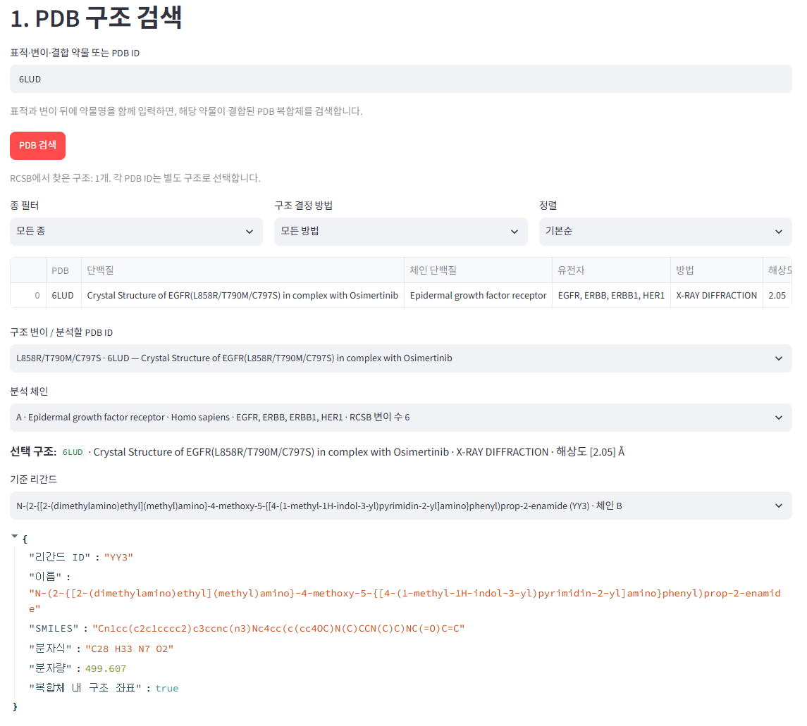
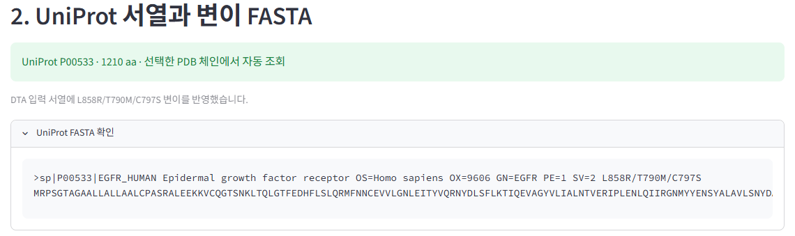
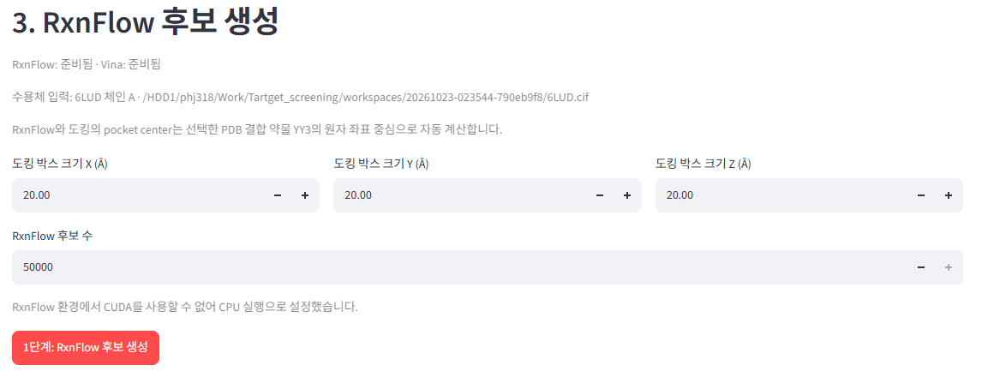
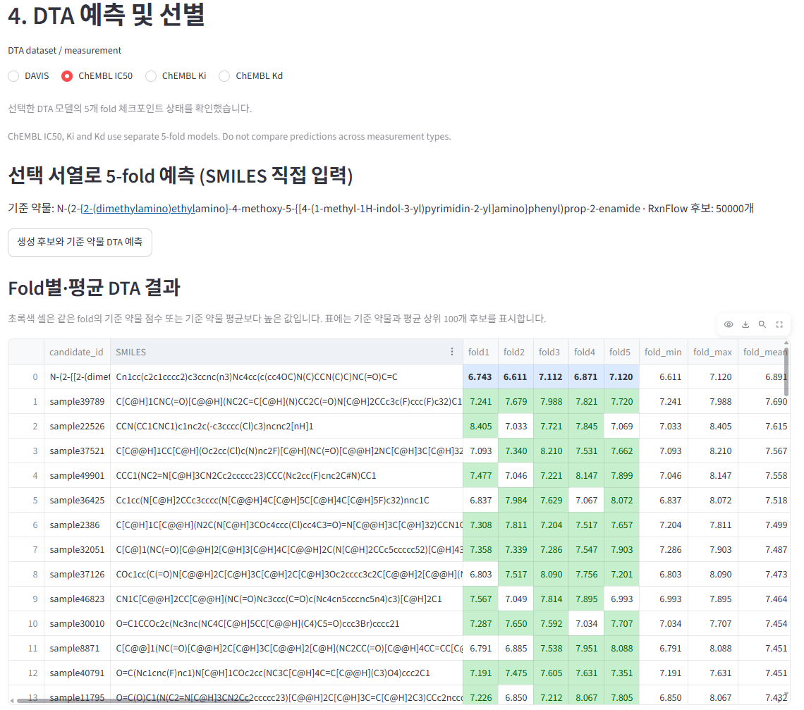
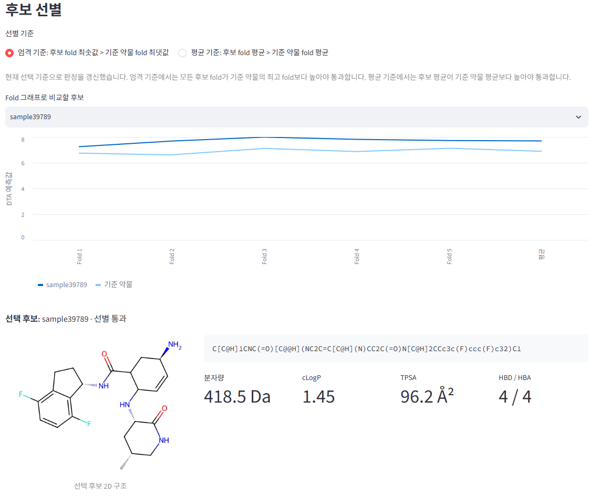
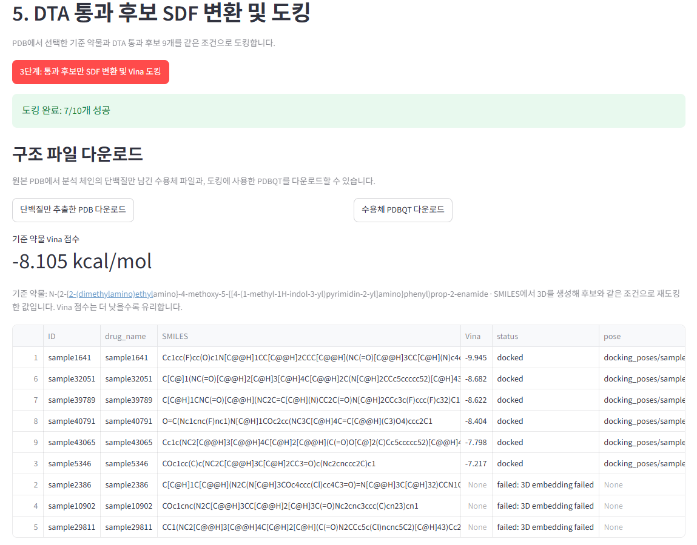

# Target Screening

## 1. Hugging Face 모델 가중치 설정

앱은 DTA 가중치를 저장소에 포함하지 않습니다. 첫 DTA 예측 때 공개 Hugging Face 저장소에서 필요한 5-fold 모델과 PLM 체크포인트를 자동으로 내려받습니다.

```bash
cp .env.example .env
```

`.env`에서 저장소 ID를 확인합니다:

```dotenv
TARGET_SCREENING_HF_REPO=Jjunyhyeon/target-screening-models
```

저장소가 공개되어 있어 계정이나 `HF_TOKEN`은 필요하지 않습니다. 다운로드 파일은 Hugging Face 캐시에 저장되어 재사용됩니다. 최초 예측 때는 인터넷 연결과 체크포인트 크기만큼의 디스크 여유 공간이 필요합니다.

모델 저장소 안의 파일 경로는 아래와 같아야 합니다 (`vendor/` 접두사 없음):

```text
PLM/checkpoint_step500000.pt
DTA_model/result/DAVIS-complete/fold1/best.pth  (fold1~fold5)
DTA_model/result/IC50/fold1/best.pth           (fold1~fold5)
DTA_model/result/Ki/fold1/best.pth             (fold1~fold5)
DTA_model/result/Kd/fold1/best.pth             (fold1~fold5)
```

모델 실행 코드는 프로젝트의 `vendor/PLM`과 `vendor/DTA_model`에 필요합니다. Hugging Face에서는 가중치 파일을 내려받습니다.

## 2. 설치 및 실행

```bash
bash start.sh
```

첫 실행에서는 필요한 환경과 도구를 준비한 뒤 Streamlit 앱을 엽니다. 브라우저가 자동으로 열리지 않으면 `http://localhost:8501`에 접속하세요.

## 3. 앱 사용 순서

### 1단계: PDB 구조 검색 및 선택

표적·변이·약물 이름 또는 PDB ID를 검색합니다. 검색 결과에서 분석할 구조, 체인, 기준 약물을 선택합니다. PDB ID를 직접 입력할 수도 있습니다.



### 2단계: UniProt 서열과 변이 FASTA 확인

선택한 PDB 체인에 연결된 UniProt 서열을 가져옵니다. 구조 주석에서 찾은 변이는 DTA 입력 FASTA에 적용됩니다.



### 3단계: RxnFlow 후보 생성

도킹 박스 크기와 후보 수를 설정한 뒤 RxnFlow로 후보를 생성합니다. 포켓 중심은 선택한 PDB의 기준 약물 좌표에서 계산합니다.



### 4단계: DTA 5-fold 예측

DAVIS 또는 ChEMBL IC50, Ki, Kd 모델을 선택하고 기준 약물과 생성 후보의 5-fold 예측을 실행합니다. ChEMBL 측정 유형별 점수는 서로 비교하지 않습니다.



### 후보 선별 및 구조 확인

결과 표 아래에서 선별 기준을 고릅니다:

- **엄격 기준:** 후보의 5개 fold 값이 모두 기준 약물의 최댓값보다 커야 통과합니다.
- **평균 기준:** 후보의 fold 평균이 기준 약물의 fold 평균보다 커야 통과합니다.

그래프에서 후보를 선택하면 2D 구조, SMILES, 분자 특성, fold별 점수를 확인할 수 있습니다. 통과 후보만 도킹 단계로 전달됩니다.



### 5단계: 기준 약물과 통과 후보 도킹

기준 약물과 DTA 통과 후보를 같은 조건으로 Vina 도킹합니다. 기준 약물 점수와 후보별 점수를 확인할 수 있으며, Vina 점수는 낮을수록 유리합니다. 기준 약물보다 점수가 더 낮은 후보만 기준 약물 PDBQT, 후보 PDBQT·도킹 포즈 및 점수 CSV와 함께 폴더 구조의 ZIP으로 내려받을 수 있습니다. 원본 PDB에서 선택 체인의 단백질만 남긴 PDB와 수용체 PDBQT도 다운로드할 수 있습니다.



## 다른 컴퓨터에서 접속

```bash
STREAMLIT_SERVER_ADDRESS=0.0.0.0 bash start.sh
```

같은 네트워크에서 실행 컴퓨터의 IP 주소와 포트 `8501`로 접속합니다.
